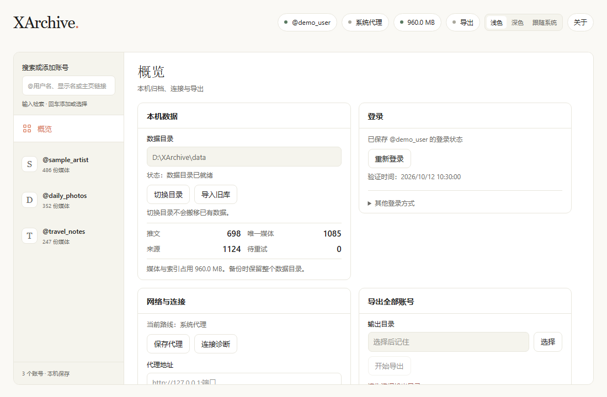

# XArchive

[](https://github.com/BErrybearl/XArchive/actions/workflows/ci.yml)

[简体中文](README.md)

A personal desktop tool for archiving media from X accounts. Built with Rust, Tauri 2, Svelte/TypeScript and SQLite, XArchive runs in its own window as a portable Windows EXE.

## Features

- Manually start full archives or incremental updates for individual accounts.
- Save images, videos, GIFs and post metadata, with content, quality and UTC date filters.
- Keep account options, progress and retry queues locally; stop when rate limited and resume manually.
- Inspect stored files, manage account data and import compatible legacy archives.
- Browse media directly in folders: layout A groups by account and month; layout C groups by account, then media type (the default). Switch layouts or organize existing files, with stop and resume support.
- Run windowless `import-legacy` / `verify` commands with JSON and Markdown reports, exit codes and a data directory lock to prevent concurrent use.
- Automatically remove the current temporary legacy copy after a successful import verification, keeping the original archive intact.
- Export local archives with full or incremental output and protection for modified files.
- Use a dedicated Edge/Chrome login profile, Windows system or explicit proxy settings, and connection diagnostics.
- Track login browsers with Windows Job Objects instead of invoking PowerShell, reducing behavior that may trigger antivirus false positives.
- Light, dark and system themes; portable data location and EXE replacement updates.

## Screenshot

<!--  -->
One overview screenshot in the light theme will be added at `docs/screenshot-overview.png`; no image is included yet. The application interface is currently in Simplified Chinese.

## Install and use

A single `XArchive.exe` is enough to run the application. Open-source licenses can be viewed in the application’s About panel. Releases also provide an optional ZIP containing the executable and accompanying documentation. Save the EXE in a writable folder, or extract the optional ZIP, then run `XArchive.exe`. Windows 10/11 and Microsoft Edge WebView2 Runtime are required; browser login also needs Edge or Chrome. End users do not need Rust or Node.js.

Create a data directory, log in, add an account and start a full archive. See the [user guide (Simplified Chinese)](使用说明.md) for login, archive options, exports, backups and updates, and the [changelog (primarily in Chinese)](CHANGELOG.md) for version changes. No automatic update service is configured.

## Build from source

Use Windows, Rust stable with the MSVC toolchain (Rust 1.90+), Node.js 24+, Microsoft C++ Build Tools with desktop C++ support and the Windows SDK, and WebView2 Runtime. Install these tools and make Cargo available on `PATH`.

```powershell
npm ci
npm run tauri:build
```

In PowerShell environments that restrict npm's `.ps1` launcher, use `npm.cmd ci` and `npm.cmd run tauri:build`. The portable executable is `src-tauri/target/release/xarchive.exe` with the default Cargo target directory. See [CONTRIBUTING.md](CONTRIBUTING.md) for checks and packaging commands.

## Data and privacy

Archives, settings, browser profiles and encrypted saved login state stay on your computer. Saved credentials are encrypted with Windows DPAPI for the current Windows user. XArchive does not upload your archive or saved login state to a developer service. It sends authenticated requests to X to perform the operations you request, and downloads media from their source servers. A dedicated browser profile contains sensitive session data too; protect the whole data directory and backups. Moving to another computer or Windows user generally requires logging in again.

## Disclaimer

XArchive is an unofficial project and is not affiliated with, endorsed by or sponsored by X Corp. It uses internal interfaces of the X website, which can change without notice. Its use may violate X's Terms of Service and may cause account restrictions or suspension. You assume these risks.

This project is intended for personal backup and archiving only. Respect content copyright and access restrictions. Do not use it for redistribution or large-scale scraping. Deleted or inaccessible content cannot be guaranteed to be archived. The software is provided without warranty; see the license.

## Acknowledgments and license

Thanks to [CandyACE/x-downloader](https://github.com/CandyACE/x-downloader), licensed under MIT, for the original downloader and the basis for the legacy implementation. Its MIT notice and dependency notices are retained in [THIRD_PARTY_NOTICES.md](THIRD_PARTY_NOTICES.md).

Copyright (c) 2026 BErrybearl. XArchive's own code is licensed under the [MIT License](LICENSE). Third-party components retain their respective licenses.
